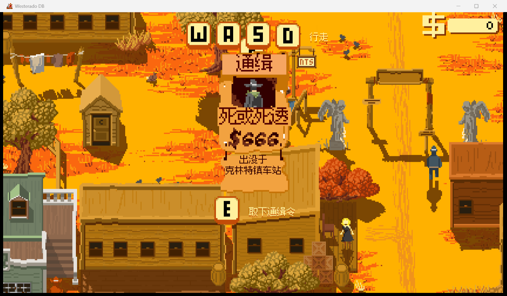
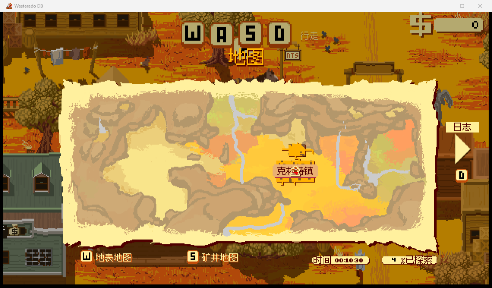
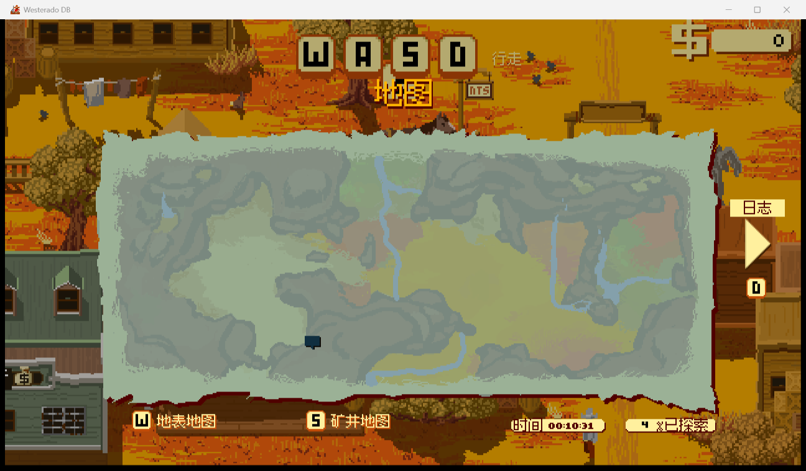

# 西部正义：双管猎枪 简体中文补丁

《Westerado: Double Barreled》非官方简体中文补丁。以原版英语文本为依据，保留英语语音与音效；GPT-6 Luna（max）初译，GPT-6.1 Sol（high）校对，中文字体使用 [Fusion Pixel Font（缝合像素字体）](https://github.com/TakWolf/fusion-pixel-font)。

## 下载与适配

- [0.1.0-rc.6 候选测试版](https://github.com/newbility/Westerado_Double_Barreled_CN/releases/tag/v0.1.0-rc.6)
- [图形安装版 ZIP](https://github.com/newbility/Westerado_Double_Barreled_CN/releases/download/v0.1.0-rc.6/Westerado_zh-CN_0.1.0-rc.6.zip) · [SHA-256 校验文件](https://github.com/newbility/Westerado_Double_Barreled_CN/releases/download/v0.1.0-rc.6/Westerado_zh-CN_0.1.0-rc.6.zip.sha256)
- 适配 64 位 Windows 上的 Steam 版，验证基线为 App ID 275200、Build ID 16510519。安装器会校验游戏资源文件的 SHA-256。
- 补丁独立可用，无需 Python、Java、开发工具库或另行安装字体。只含差分及允许再分发的组件，不含完整游戏。

## 安装与恢复

1. 关闭游戏，解压整个 ZIP，双击 `Install-GUI.cmd`。
2. 点击「浏览」选择游戏目录，或手动输入、粘贴路径；请选择含 `WesteradoDB.exe` 的文件夹。
3. 点击「安装 / 升级」。保留有效原版备份的 rc.1—rc.5 可直接升级。
4. 同一个窗口可「检查状态」或「恢复英文原版」。请保留游戏目录中的 `.westerado-cn-backup`。安装脚本不读写游戏存档。

## 本次更新

- 修正通缉令「活捉」「死或活」「死或死透」等要求的字体发虚与拥挤，调整赏金、地点和交互提示的间距。
- 补齐通缉令的「出没于」、森林、沙漠和克林特镇车站，修正地点名称拆分后残留英文的问题。
- 修正地图、日志、线索和控制等侧栏标签，以及地图时间和探索比例的文字区域；复查旧按键示意、微型通缉令和线索通知图片。
- 统一图片文字的完整像素绘制入口，并检查后续图片绘制是否覆盖已绘制的中文字形。
- 保留此前存档、标题、副标题、招牌与中文数字对齐修复，以及雕像、墓碑、路牌、物品介绍、土匪姓名、脚本台词、加载和按键提示的汉化。18 处图片招牌修复继续保留，NTS 保留原品牌缩写。
- 累计 55 批、6,480 条原文完成初译及校对。各阶段与修订记录分别保留。

## 实测范围与限制

- 隔离游戏实测三种通缉要求与五个地点的 15 种组合；在 640×360 复查最长车站名称，在 640×360、1280×720 检查地表与矿井地图，并检查日志标签与页面。场景通过测试驱动调用游戏原组件，部分使用隔离测试数据；测试驱动及测试数据不进入玩家补丁。这些检查不等于自然任务流程或完整通关。
- 静态盘点 350 个导出脚本、147 处字体／文本／缩放调用、12 个直接 TextField 类。原生渲染检查覆盖 92 个已登记图片资源、189 次文字绘制及 7 套字体的 70 个字号样例，并检查最终字形是否遭后续绘制覆盖；已登记样例未发现中间透明像素。开发调试文字和未使用的旧设置占位另行列明。
- 从最终 ZIP 解包后通过 73 项安装检查，包含 rc.1—rc.5 升级、备份缺失时拒绝升级、安装校验和恢复；图形入口另实测手输目录、浏览选择、安装、校验和恢复。公开附件使用这份已测试的 ZIP，不重新打包。
- 保留此前标题、存档读档、图像／音频／按键设置、雕像、路牌、酒馆招牌等场景的验证记录。本次尚未完成完整剧情、所有分支与结局、合作游玩、全部建筑与动画状态、其他分辨率及硬件、无字幕语音的全面核查。登记范围外的图片与未游玩状态仍可能存在遗漏，本版本继续标记为候选测试版。

## 组件与许可

中文译文采用 CC BY-NC-SA 4.0；游戏原文及资源权利仍属于其权利人。Fusion Pixel Font 使用 OFL-1.1，随附字源许可；xdelta3 解码器为 GPL-2.0-or-later，包内附对应源码、组件许可及来源信息。译文协议不替代字体和程序各自的许可证。

## 关于「解锁帧率」

游戏设置中有一项【解锁帧率】选项，**强烈建议不要开启**。原因是本作存在一个与帧率相关的对话显示问题：对于游戏中自动触发、无需玩家手动交互的对话，当文字内容全部显示完成后，对话框会在很短时间内自动消失。该问题在英文原版中同样存在，但中文版会更加明显。这是因为中文通常能够用更少的字符表达与英文相同的信息，导致中文字幕更快完成全部文字的显示，从而更早触发对话框自动消失。帧率越高，这一过程也会越快。实际测试中，将游戏帧率固定在 **30 FPS** 时，自动对话显示完成后的停留时间会明显长于解除帧率限制的情况，因此阅读体验会更加稳定。所以**强烈建议不要开启【解锁帧率】。**

## 实机截图

## 版权与免责声明

1. 本补丁仅供学习与交流使用，不得用于任何商业用途，请在已购买正版游戏的前提下使用。
2. 游戏文本及资源的版权归开发者/发行商所有；中文译文采用CC BY-NC-SA 4.0 协议；字体使用 Fusion Pixel Font（缝合像素字体，12 px 简体中文等宽版），遵循 SIL Open Font License 1.1（OFL-1.1）。如有侵权，请联系移除。
3. 本汉化包为非官方汉化程序，对于使用汉化包而造成的任何损失，本人不负任何责任。
4. 您肯定已经详细阅读并已理解本协议，并同意严格遵守免责声明的各条款和条件。如不同意，请勿使用。
