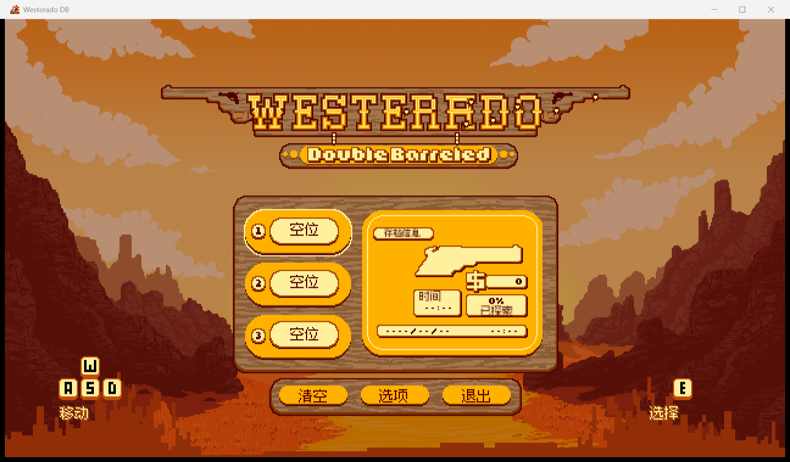
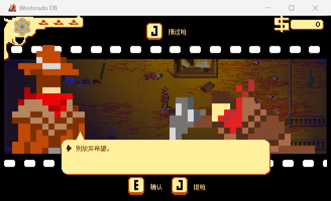
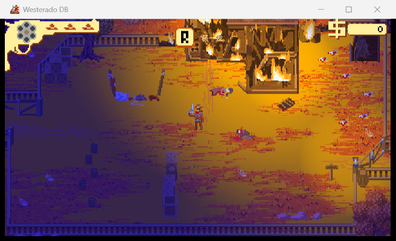

# 西部正义：双管猎枪 简体中文补丁

《Westerado: Double Barreled》非官方简体中文补丁。以原版英语文本为依据，保留原版英语语音与音效，使用缝合像素字体。

## 下载与适配

- [0.1.0-rc.3 候选测试版](https://github.com/newbility/Westerado_Double_Barreled_CN/releases/tag/v0.1.0-rc.3)
- [图形安装版 ZIP](https://github.com/newbility/Westerado_Double_Barreled_CN/releases/download/v0.1.0-rc.3/Westerado_zh-CN_0.1.0-rc.3.zip) · [SHA-256 校验文件](https://github.com/newbility/Westerado_Double_Barreled_CN/releases/download/v0.1.0-rc.3/Westerado_zh-CN_0.1.0-rc.3.zip.sha256)
- 适配 64 位 Windows 上的 Steam 版，验证基线为 App ID 275200、Build ID 16510519。安装器会校验两个游戏资源文件的 SHA-256。

## 安装与恢复

1. 关闭游戏，解压整个 ZIP，双击 `Install-GUI.cmd`。
2. 点击「浏览」选择游戏目录，或直接输入或粘贴路径。请选择含 `WesteradoDB.exe` 的文件夹。
3. 点击「安装 / 升级」。保留有效原版备份的 rc.1、rc.2 可直接升级。安装器在写入前校验资源，存档不受影响。
4. 可以在同一窗口点击「检查状态」或「恢复英文原版」。请保留游戏目录里的 `.westerado-cn-backup`。

## 版本变更与实测范围

- rc.3 修正哥哥交枪场景的「接过枪」「确认」和「装一发」，调整对话选项按钮间距。补译 22 条按键提示，覆盖武器切换、日志、挣脱和牌桌等操作。
- 保留 rc.2 的存档页、设置和按键标签排版修正。实测覆盖开场对话、存档页、图像、音频、改键弹窗、角色选择和暂停菜单，涉及 640×360 与 1280×720 窗口。
- 37 个提示通过运行时检查，图形安装及恢复已实测，另通过 46 项命令行安装检查。牌桌和其他分支的提示尚未逐场景触发，完整剧情、所有分支、多人模式、其他分辨率及逐条英语听音校对仍未覆盖。

## 关于「解锁帧率」

游戏设置中有一项【解锁帧率】选项，**强烈建议不要开启**。原因是本作存在一个与帧率相关的对话显示问题：对于游戏中自动触发、无需玩家手动交互的对话，当文字内容全部显示完成后，对话框会在很短时间内自动消失。该问题在英文原版中同样存在，但中文版会更加明显。这是因为中文通常能够用更少的字符表达与英文相同的信息，导致中文字幕更快完成全部文字的显示，从而更早触发对话框自动消失。帧率越高，这一过程也会越快。实际测试中，将游戏帧率固定在 **30 FPS** 时，自动对话显示完成后的停留时间会明显长于解除帧率限制的情况，因此阅读体验会更加稳定。所以**强烈建议不要开启【解锁帧率】。**

## 实机截图

## 版权与免责声明

1. 本补丁仅供学习与交流使用，不得用于任何商业用途，请在已购买正版游戏的前提下使用。
2. 游戏文本及资源的版权归开发者/发行商所有；中文译文采用CC BY-NC-SA 4.0 协议；字体使用 Fusion Pixel Font（缝合像素字体，12 px 简体中文等宽版），遵循 SIL Open Font License 1.1（OFL-1.1）。如有侵权，请联系移除。
3. 本汉化包为非官方汉化程序，对于使用汉化包而造成的任何损失，本人不负任何责任。
4. 您肯定已经详细阅读并已理解本协议，并同意严格遵守免责声明的各条款和条件。如不同意，请勿使用。
