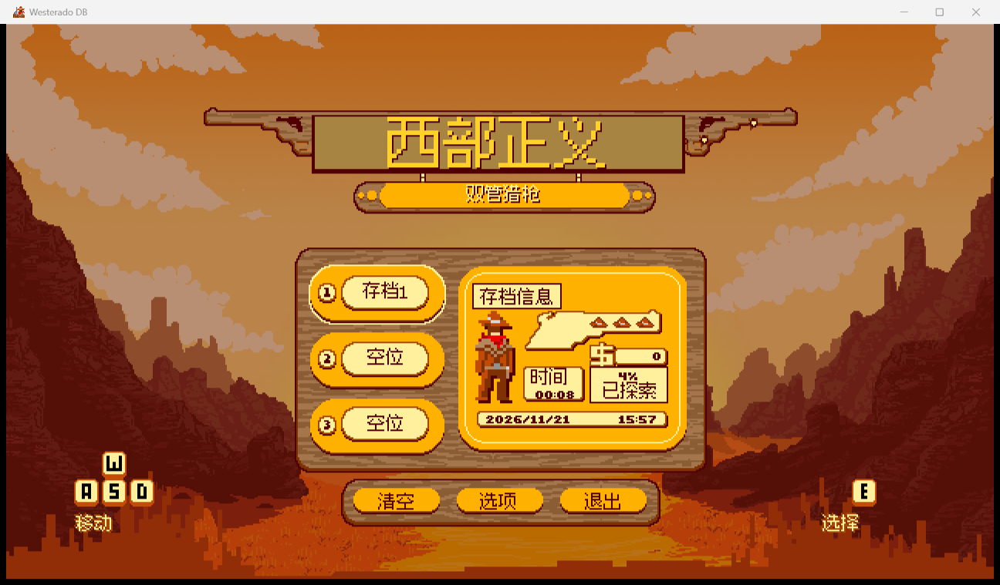
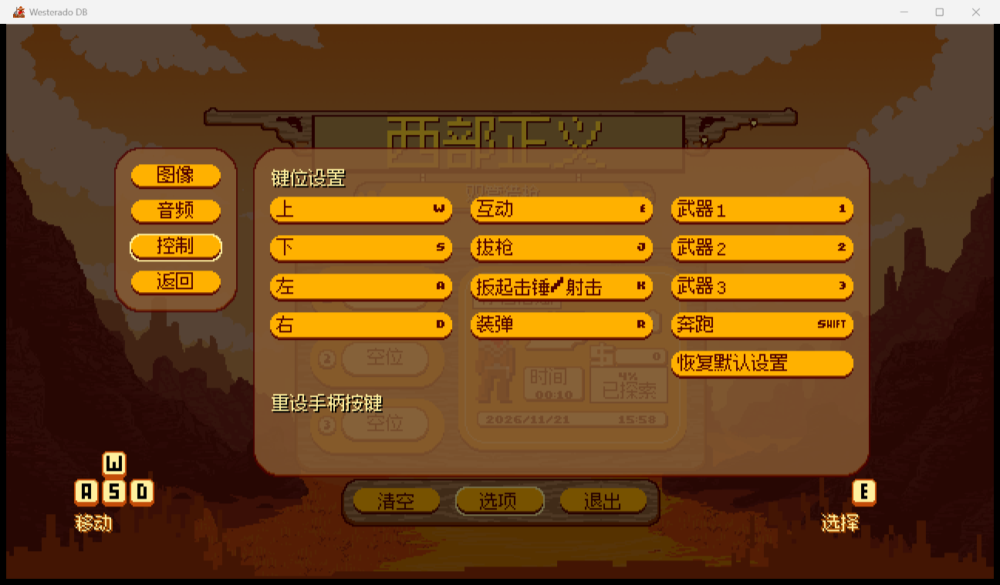
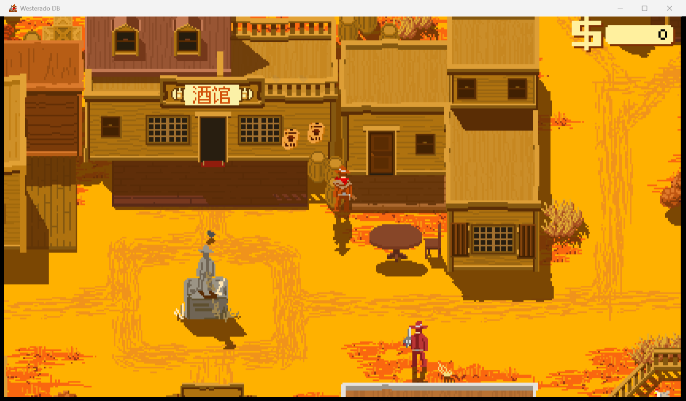
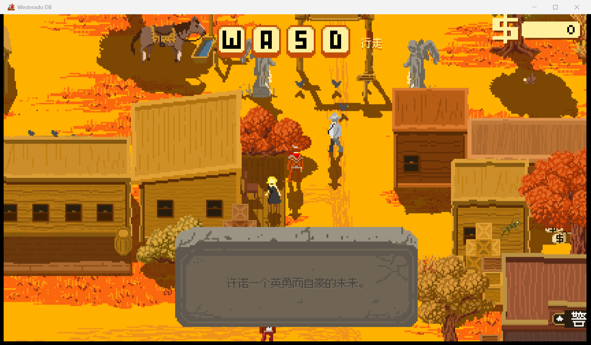

# 西部正义：双管猎枪 简体中文补丁

《Westerado: Double Barreled》非官方简体中文补丁。以原版英语文本为依据，保留英语语音与音效；GPT-6 Luna（max）初译，GPT-6.1 Sol（high）校对，中文字体使用 Fusion Pixel Font（缝合像素字体）。

## 下载与适配

- [0.1.0-rc.5 候选测试版](https://github.com/newbility/Westerado_Double_Barreled_CN/releases/tag/v0.1.0-rc.5)
- [图形安装版 ZIP](https://github.com/newbility/Westerado_Double_Barreled_CN/releases/download/v0.1.0-rc.5/Westerado_zh-CN_0.1.0-rc.5.zip) · [SHA-256 校验文件](https://github.com/newbility/Westerado_Double_Barreled_CN/releases/download/v0.1.0-rc.5/Westerado_zh-CN_0.1.0-rc.5.zip.sha256)
- 适配 64 位 Windows 上的 Steam 版，验证基线为 App ID 275200、Build ID 16510519。安装器会校验游戏资源文件的 SHA-256。
- 补丁独立可用，无需 Python、Java、开发工具库或另行安装字体。只含差分及允许再分发的组件，不含完整游戏。

## 安装与恢复

1. 关闭游戏，解压整个 ZIP，双击 `Install-GUI.cmd`。
2. 点击「浏览」选择游戏目录，或手动输入、粘贴路径；请选择含 `WesteradoDB.exe` 的文件夹。
3. 点击「安装 / 升级」。保留有效原版备份的 rc.1、rc.2、rc.3、rc.4 可直接升级。
4. 同一个窗口可「检查状态」或「恢复英文原版」。请保留游戏目录中的 `.westerado-cn-backup`。安装脚本不读写游戏存档。

## 本次更新

- 修正「存档信息」「时间」「已探索」「双管猎枪」及招牌文字发虚；使用完整像素字形，并调整小标签与数值的位置。
- 对齐「存档1／2／3」等中文标签中的数字，保留原版英文字形和纯数字界面的样式。
- 相比此前公开的 rc.3，补齐雕像、墓碑、路牌、物品介绍、土匪姓名和代码台词、加载提示、中文大标题、默认存档名称、单人／合作／取消选项及 18 处图片招牌。NTS 保留原品牌缩写。
- 保留此前的接过枪、确认、单发装弹等按键提示和设置页排版修正。累计 54 批、6,476 条原文完成初译及校对。

## 实测范围与限制

- 隔离游戏实测 640×360、1280×720 的标题、存档与读档，以及图像、音频、按键设置；复查雕像、方向路牌、土匪姓名与台词、加载提示、酒馆招牌。部分场景使用测试驱动触发游戏原组件，测试驱动不进入玩家补丁。
- 原生渲染检查 216 条世界文本映射、18 处招牌与 8 个混排／标签样例；另检查源文、控制标记、字体覆盖和原对话逻辑保留。
- 从最终 ZIP 解包后通过 64 项安装检查，包含 rc.1—rc.4 升级、原版备份缺失时拒绝升级、安装校验和恢复；图形入口另实测手输目录、浏览选择、安装、校验和恢复。
- 2026-11-21，项目使用者反馈试用后「暂时没发现什么问题」。这不代表完整通关：完整剧情、所有分支与结局、合作游玩、全部建筑状态、其他分辨率及逐条英语听音校对仍未覆盖。本版本继续标记为候选测试版。

## 组件与许可

中文译文采用 CC BY-NC-SA 4.0；游戏原文及资源权利仍属于其权利人。Fusion Pixel Font 使用 OFL-1.1，随附字源许可；xdelta3 解码器为 GPL-2.0-or-later，包内附对应源码、组件许可及来源信息。译文协议不替代字体和程序各自的许可证。

## 关于「解锁帧率」

游戏设置中有一项【解锁帧率】选项，**强烈建议不要开启**。原因是本作存在一个与帧率相关的对话显示问题：对于游戏中自动触发、无需玩家手动交互的对话，当文字内容全部显示完成后，对话框会在很短时间内自动消失。该问题在英文原版中同样存在，但中文版会更加明显。这是因为中文通常能够用更少的字符表达与英文相同的信息，导致中文字幕更快完成全部文字的显示，从而更早触发对话框自动消失。帧率越高，这一过程也会越快。实际测试中，将游戏帧率固定在 **30 FPS** 时，自动对话显示完成后的停留时间会明显长于解除帧率限制的情况，因此阅读体验会更加稳定。所以**强烈建议不要开启【解锁帧率】。**

## 实机截图

## 版权与免责声明

1. 本补丁仅供学习与交流使用，不得用于任何商业用途，请在已购买正版游戏的前提下使用。
2. 游戏文本及资源的版权归开发者/发行商所有；中文译文采用CC BY-NC-SA 4.0 协议；字体使用 Fusion Pixel Font（缝合像素字体，12 px 简体中文等宽版），遵循 SIL Open Font License 1.1（OFL-1.1）。如有侵权，请联系移除。
3. 本汉化包为非官方汉化程序，对于使用汉化包而造成的任何损失，本人不负任何责任。
4. 您肯定已经详细阅读并已理解本协议，并同意严格遵守免责声明的各条款和条件。如不同意，请勿使用。
